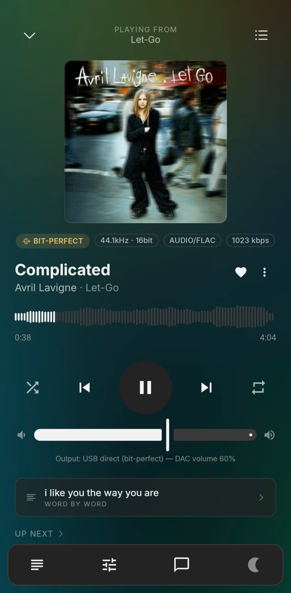
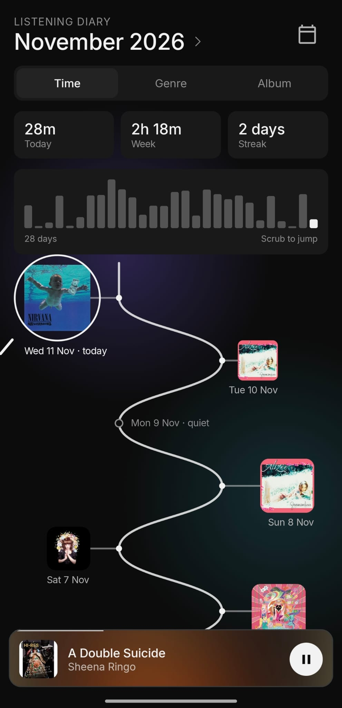
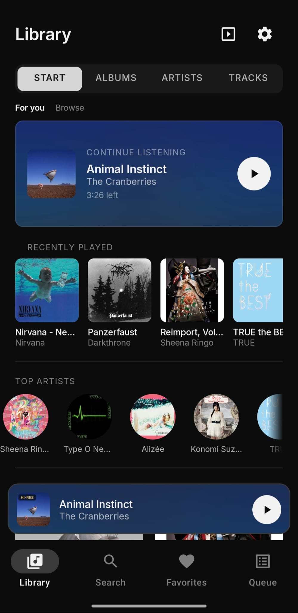
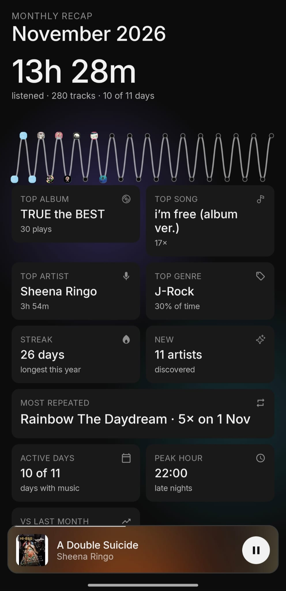
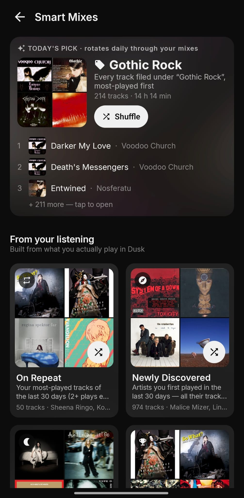
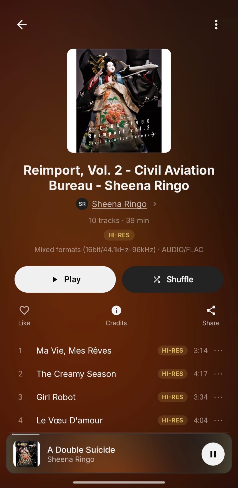
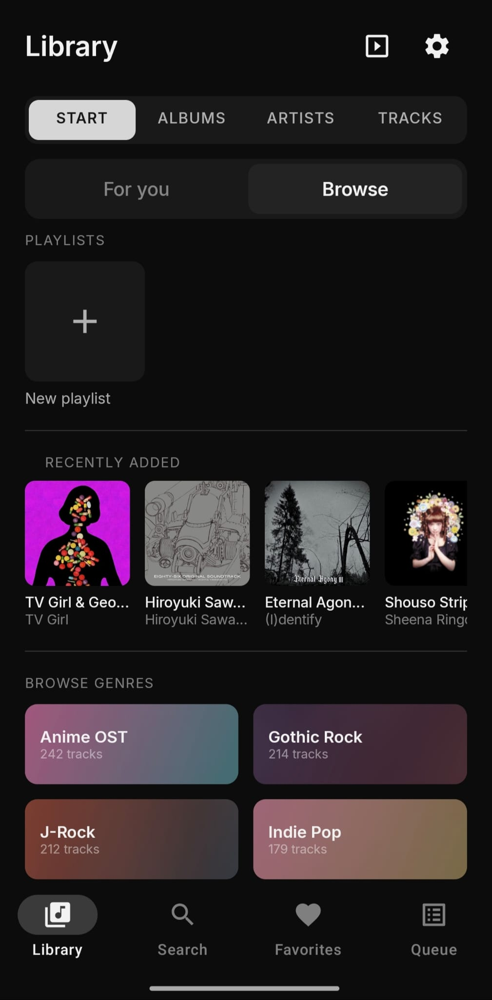
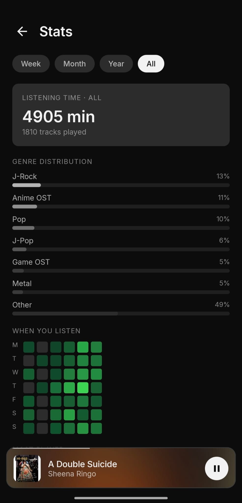
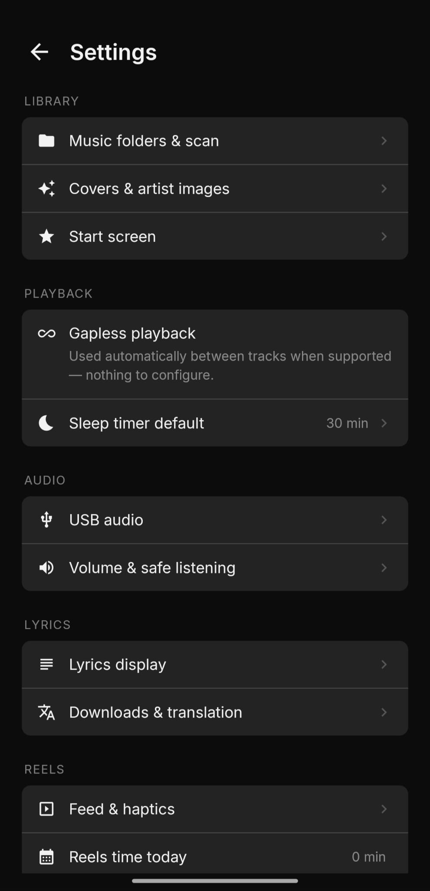

# Demilune

*Direct. Untouched. Synced. Kept.*

**A music player for people who still keep their own files.**
No streaming, no account, no ads, nothing uploaded. You point it at your folders and it plays your library
the way you would want it played: untouched on the way to your DAC, with lyrics that follow every word,
and a few small features that make a big collection feel like yours.

  
  
  

> **[Download the latest APK](https://github.com/ilvy23/demilune/releases/latest)** · Android 10 or newer · free
> Not sure how to install it? Jump to the [install guide](#install-guide). After the first install the app updates itself.

---

## Why this exists

Android's audio system is built for convenience, not for purity. Everything you play goes through a mixer that
may resample it, may apply its own gain, and decides for you what reaches the DAC. For most people that is fine.
If you own a decent USB DAC or a USB-C IEM cable, you might want something different: **the file, exactly as it is on disk,
at the volume you set on the DAC itself.** That is what Demilune's USB path does. The rest of the app is built so that
the music is the thing you look at, not the interface.

## For the audio nerds

I try not to oversell this part, so here is exactly what happens and what does not.

**What Demilune does**
- **Own USB audio driver for UAC2 DACs.** Demilune talks to the DAC directly and sends the decoded samples as they are.
  No Android mixer in between, no resampling, no system equaliser, no loudness tricks.
- **Hardware volume.** The slider, your phone's volume keys, your headset buttons and Bluetooth controls change the
  **DAC's own volume**, not a software gain. A session always starts at 50 % so a plugged-in DAC never blasts you.
- **Native rates and bit depths.** If the DAC accepts the file's sample rate and bit depth, that is what it gets
  (as far as your DAC supports them). The Now Playing screen shows the actual path and format
  ("Output: USB direct (bit-perfect), DAC volume 60 %").
- **It stays there.** While a capable DAC is connected, Demilune does not hop back to Android audio on pause, track change, seek
  or a short hiccup. You can turn this off in Settings › Audio.
- **Honest fallback.** Plenty of USB-C adapters are simple UAC1 devices, or a file's format does not fit the DAC.
  In these cases Demilune hands the device back to Android and plays through the normal path at the same position,
  with a short note instead of an error. If anything ever misbehaves, Settings › Audio › USB audio mode lets you choose
  "Android system output".
- **Gapless playback**, FLAC, ALAC, WAV, MP3, AAC, Opus and Vorbis as far as Android decodes them.
- **Hi-Res badges** for 24-bit and high-rate files, a waveform seek bar, safe-volume tools and a sleep timer.

**What it does not do**
- It does not claim to "sound better". Bit-perfect means nothing touches the signal, not that you will hear a difference.
  If your cable has DSP presets (like the Moondrop cables), those still run inside the cable, exactly as you set them there.
- It cannot change what a device refuses to do. A DAC without a volume control gets the Android path.
- Not every DAC has been tested. I developed it with the **Moondrop DUSK USB-C cable** on a **Xiaomi 15T Pro**.
  If you have another DAC or dongle, please [tell me how it went](#feedback-and-bug-reports); that is the most useful thing you can do.

**Bluetooth and wired headphones** use the normal Android route: connect or disconnect while playing and Demilune follows
(it pauses on unplug instead of blasting the speaker), media buttons and car displays work, calls and navigation prompts
duck and resume.

---

## The rest of the app

**Library**
- Choose one or more music folders. Demilune reads **only** what is inside them, and a rescan removes what is gone.
- Fast incremental scanning; collab artists are folded into the main artist and spelling variants are merged.
- Playlists, favourites, smart mixes ("On repeat", "Newly discovered", genre mixes), artist images you pick yourself
  (with a crop tool, stored privately so they never appear in your gallery). Cover files can be hidden from gallery apps.

**Lyrics**
- Synced lyrics, **word by word**, coloured from the cover art. Optional subtitles under each line.
- Demilune reads lyrics you already have (embedded tags, `.lrc` files, imported files). When you ask for a song's lyrics,
  it looks them up on [LRCLIB](https://lrclib.net), a community lyrics database.

**Your listening, as a picture**
- **Listening diary:** a winding path of your days, each with the album you played most. Tap a day and it opens into a tree of
  every song you heard, sized by how often. Pinch to zoom; it keeps working with hundreds of songs in a day.
- Monthly recap, stats, streaks, **Reels** (a vertical feed of short moments of your own songs) and small music-driven games if you want them.

**Easy on the phone**
- Animations adapt to your device (auto, full, reduced, performance mode). It runs on modest phones.

  
  
  

  
  
  

*Album covers in the screenshots come from the author's own library.*

---

## Requirements

| | Minimum | Recommended |
|---|---|---|
| Android | 10 (API 29) | 12 or newer |
| RAM | 3 GB | 6 GB or more |
| CPU | ARM, 32 or 64 bit | any recent ARM64 phone |
| Storage | about 100 MB for the app | plus your music |
| Audio | any headphones, Bluetooth or USB | a UAC2 USB DAC or USB-C IEM cable for the bit-perfect path |

A phone with a USB-C port and a DAC you already like is all you need. No root, no special permissions.

---

## Install guide

**1. Download**
Open the [download page](https://github.com/ilvy23/demilune/releases/latest) on your phone and tap the
`demilune-full-….apk` file under *Assets*.

**2. Allow the installation**
Android blocks apps from outside the Play Store by default. When you open the file it asks you to allow your
browser (or file manager) to install apps: tap **Settings**, switch on **Allow from this source**, go back and tap **Install**.
- *Samsung, Xiaomi and others:* the wording differs a little; look for "Install unknown apps" or "Allow from this source".
- *Google Play Protect* may say the app is from an unknown developer. Tap **More details › Install anyway**. That is normal for apps outside the store.

**3. First start**
1. Open **Demilune**.
2. Tap **Choose music folder**, pick the folder with your music, then **Use this folder** and allow access.
   (You can add more folders later in Settings › Library › Music folders & scan.)
3. Allow notifications (for the player controls) and, if asked, battery optimisation (so playback is not killed in the background).
4. Wait while the library scans; the first scan of a big library can take a few minutes.

**4. USB DAC or IEM cable**
Plug it in. Demilune asks for permission to use the USB device; allow it. If the device is suitable, the Now Playing screen shows
**BIT-PERFECT** and the DAC volume. If it plays through Android instead, you will see "Playing through Android audio", and that is fine.

**5. Updates**
Demilune checks this page once a day and downloads updates over Wi-Fi by default (Settings › About › Check now). When a new version is ready you get a message;
confirm the installation and you are done. Your library and settings stay.

**If something goes wrong**
- *"App not installed":* an older copy signed with a different key is installed. Uninstall it first (this deletes its data), then install again.
- *Library is empty:* make sure you picked the folder that contains the music, then Settings › Library › Rescan.
- *No sound over USB:* Settings › Audio › USB audio mode › **Android system output**, then tell me which device it was.
- *Playback stops in the background:* allow Demilune to ignore battery optimisation (Settings › Apps › Demilune › Battery).

---

## Privacy

- No account, no analytics, no ads, no tracking. Your listening history stays on your phone.
- The app goes online for two things only: the update check against this repository, and a lyrics lookup on LRCLIB when you ask for it.
- You can switch the update check off in Settings.
- Cloud backup is off; the app's data is not uploaded anywhere.

## Known limits

- Closed source for now. Releases are signed so that updates can be verified.
- Some Android skins stop background apps aggressively.
- Android 11 and older cannot discover Bluetooth devices for phone-to-phone transfer.

## Feedback and bug reports

Open an issue here and include: phone model, Android version, the USB or Bluetooth device, and what you saw.
For audio problems the device name matters most. Please do not attach music files.

---

## Copyright and licence

**Demilune © 2026 Ilvy (ilvy23). All rights reserved**, except for what [LICENSE.md](LICENSE.md) grants you:
free personal use, and redistribution of the **unmodified** app **with credit to the author and a link to this page**.
Selling it, modifying or repackaging it, removing notices, or presenting it as your own is not allowed.
Third-party components keep their own licences (fonts under the SIL Open Font License, icons under MIT, and others).

*Demilune is an independent project and is not affiliated with or endorsed by Moondrop or any other DAC or headphone maker.*
